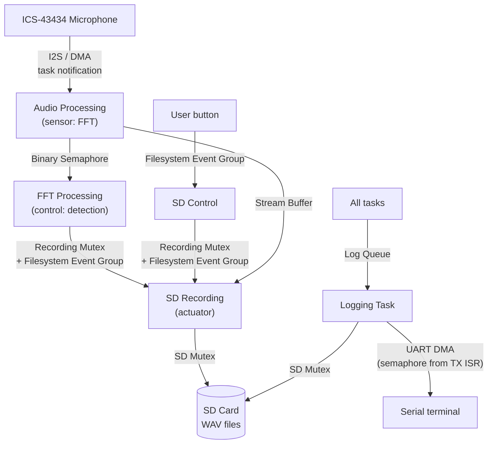
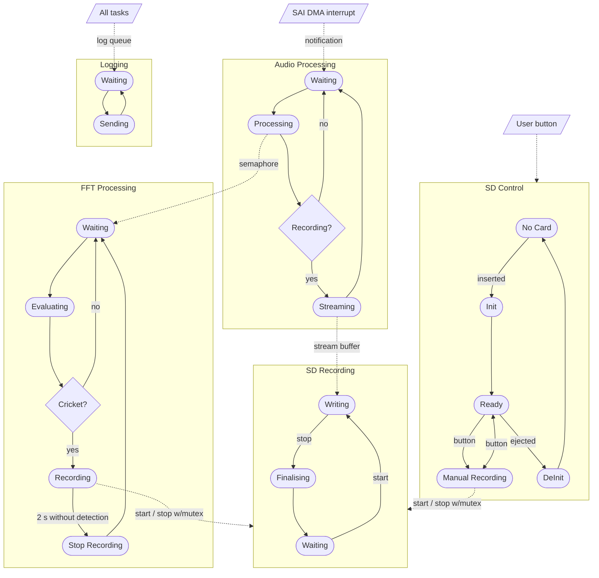

# MENG4030 – Cricket Chirp Detector on FreeRTOS

This repository holds my sprint work for MENG4030. Over five sprints I built a FreeRTOS application on the STM32 NUCLEO-L476RG. It listens through an I²S MEMS microphone, detects cricket chirps with an FFT, and records them to an SD card as WAV files.

## Hardware

- STM32 NUCLEO-L476RG
- ICS-43434 I²S MEMS microphone (SAI2)
- microSD card (SDMMC1, FatFs)
- TMP3 I²C temperature sensor (Sprint 2 practice sensor)

## Sprints

| Sprint | Topic | What it adds to the project |
|---|---|---|
| [Sprint 1](Sprint1) | Toolchain, GPIO, UART, first RTOS task | Board setup, serial debug output, first FreeRTOS task |
| [Sprint 2](Sprint2) | Sensor read task, bare-metal vs FreeRTOS | Reading the ICS-43434 microphone over I²S |
| [Sprint 3](Sprint3) | Multiple tasks, context switching | Separate sensor and control tasks; FFT of the audio |
| [Sprint 4](Sprint4) | Queues and task communication | DMA audio streaming, tone detection, WAV recording to SD |
| [Sprint 5](Sprint5) | Logging, semaphores and mutexes | Logging task, two-species cricket detection, automatic recording |

Each sprint folder has a README covering the implementation, results and reflection. Sprint 5 is the most complete version of the project.

## System overview (Sprint 5)

## System state machine

Solid arrows are transitions within a task; dashed arrows are signals between tasks. Whichever task holds the recording mutex owns the recording, so a button press can't interrupt a cricket recording and a cricket can't take over a manual one.

A cricket is detected after 5 hits in the last 8 FFT blocks, where a hit means the cricket band stands out from both its noise floor and the rest of the spectrum.

## Building

Each sprint subfolder is a self-contained STM32CubeMX/CMake project. From inside a project folder:

This builds `build/Debug/<Project>.elf`, which can be flashed with STM32CubeIDE or STM32CubeProgrammer. The projects can also be opened directly in STM32CubeIDE.
