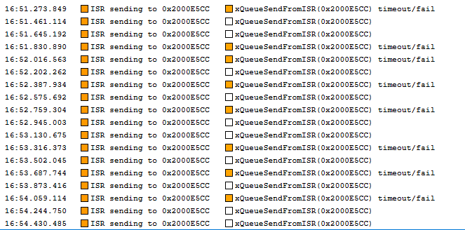
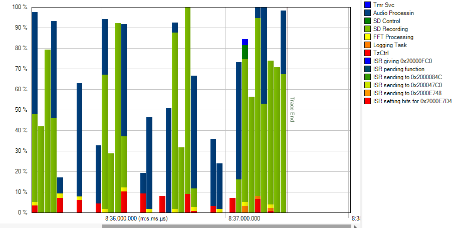
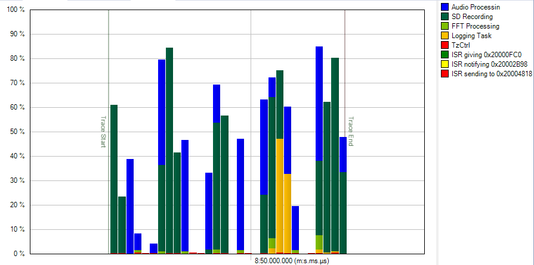
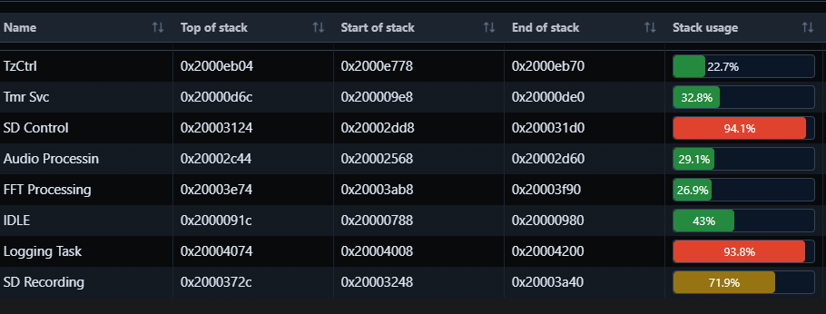
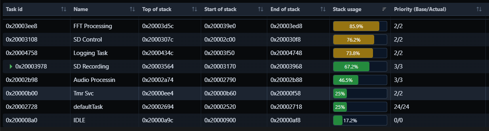

# Sprint 5 – Logging, Semaphores and Mutexes

## Overview

This sprint adds a logging task fed by a queue, and uses semaphores and mutexes to coordinate tasks that share resources. In the cricket detector, every task now logs through one logging task to both UART and `log.txt` on the SD card. Detection is extended to two species, the Southeastern Field Cricket (4.7 kHz) and the Fall Field Cricket (4.2 kHz), and a detection starts a recording automatically.

Project: [`Part1`](Part1)

## Implementation

### Task structure

| Task | Priority | Role |
|---|---|---|
| `vAudioProcessingTask` | 3 | Sensor: windowed FFT of each DMA block, feeds the recording stream |
| `vFFTProcessingTask` | 2 | Control: cricket detection, starts and stops recordings |
| `vSDRecordingTask` | 3 | Actuator: writes the WAV file |
| `vSDCardCTLTask` | 2 | SD insert/eject and the record button |
| `vLoggingTask` | 2 | Drains the log queue to UART and `log.txt` |

### Logging task, queue and semaphore

Any task calls `vLogMessage()`, which adds the task name and tick count and sends the message to the log queue. The logging task is the only one that uses the UART, sending each message with DMA.

**Deviation from the handout:** the handout has producers give a binary semaphore after each `xQueueSend` to wake the logger. Blocking on the queue already wakes the logger when a message arrives, so I used the semaphore for the UART's transmit-complete interrupt. The DMA reads straight from the logger's message buffer, so the task must wait for the transfer to finish before it receives the next message into that buffer. This is still the core idea of a binary semaphore: an event, here from an ISR, unblocks a task.

```c
void vLogMessage(const char* fmt, ...) {
  char buff[256];
  snprintf(buff, sizeof(buff), "[%s Tick:%ld] ", pcTaskGetTaskName(NULL), xTaskGetTickCount());
  ...
  xQueueSend(xhLoggingQueue, buff, 100);
}

/* vLoggingTask */
if(xQueueReceive(xhLoggingQueue, Message, portMAX_DELAY) == pdPASS)
{
  UART_Printf(Message);                                 // UART DMA
  xSemaphoreTake(xSDBusyMutex, portMAX_DELAY);
  f_write(&LogFile, Message, strlen(Message), &bytesWritten);   // log.txt
  xSemaphoreGive(xSDBusyMutex);
  xSemaphoreTake(xLoggingSemaphore, portMAX_DELAY);     // wait for UART DMA to finish
}

void HAL_UART_TxCpltCallback(UART_HandleTypeDef *huart) {
  xSemaphoreGiveFromISR(xLoggingSemaphore, &xHigherPriorityTaskWoken);
  ...
}
```

### Mutexes

**Deviation from the handout:** the handout puts a mutex around the UART. Since only the logging task touches the UART, there is nothing to contend for. The resources that are actually shared got mutexes instead:

- **`xSDBusyMutex`** protects FatFs. The recording task (WAV data), the logging task (`log.txt`) and the SD control task (init/eject) all use the card, and every `f_*` call is wrapped in this mutex.
- **`xRecordingMutex`** decides who owns a recording. A recording can be started either by the FFT task (cricket detected) or by the SD control task (button press). Whichever task takes the mutex owns the recording, and the other is refused until it is released:

```c
} else if (want) {
  if (xSemaphoreTake(xRecordingMutex, 0) == pdPASS) {
    xEventGroupSetBits(xhFilesystemEventGroup, SD_RECORDING_ACTIVE);
    vLogMessage("Cricket detected, recording started\r\n");
  } else if (!recordingAttempted) {
    vLogMessage("Recording already in progress\r\n");
    ...
```

### Adaptive cricket detection

A fixed dBFS threshold either missed quiet crickets or triggered on loud noise. The detection is now relative to the background, and a peak in each band counts as a hit only when it is:

1. at least 6 dB above that band's learned noise floor, which follows the signal slowly with an exponential moving average (more slowly during hits, so a chirp doesn't raise its own floor), and
2. at least 15 dB above the mean of the whole spectrum (about 0.9–16 kHz). A broadband noise spike such as a clap or knock raises the whole spectrum, so it fails this test even though it's loud.

A cricket is reported only when 5 of the last 8 FFT blocks were hits, so one-off spikes are ignored. Detection is held for 2 s after the last hit so recordings don't stop between chirps.

```c
uint8_t hit1 = blocks > (uint32_t)(3.0f * SAMPLE_RATE / FFT_LENGTH) && mag1 >= floor1 + 6.0f && prom1 >= 15.0f;   // skip first ~3 s
hist1 = (hist1 << 1) | hit1;
uint8_t cricket1 = __builtin_popcount(hist1) >= 5;

float32_t a1 = hit1 ? 0.0005f : 0.01f;   // adapt slowly during hits
floor1 += a1 * (mag1 - floor1);
```

### Stream buffer for recording

The SAI interrupts now send a task notification saying which half of the DMA buffer is ready, and the audio task reads that half in place. Audio for the SD card goes through a **stream buffer** instead of a queue. The trigger level is 4 KB, so the recording task only wakes once there is a large block to write:

```c
xhRecordingStream = xStreamBufferCreateStatic(RECORDING_STREAM_SIZE, RECORDING_STREAM_TRIGGER_LVL,
                                              RecordingStreamStorageBuffer, &xRecordingStream);

/* vAudioProcessingTask */
if(SD_CHECKFLAGS(SD_RECORDING_ACTIVE))
  xStreamBufferSend(xhRecordingStream, packed_24bit_buf, AUDIO_BLOCK_LEN_WORDS*3, 0);

/* vSDRecordingTask */
size_t bytes = xStreamBufferReceive(xhRecordingStream, raw_audio_samples2, sizeof(raw_audio_samples2), pdMS_TO_TICKS(100));
```

## Results

The SD card's `log.txt` ([`assets/log.txt`](assets/log.txt)) shows the system working end to end:

```
[FFT Processing Tick:310564] Detected Southeastern Field Cricket: -85.68 dBFS
[FFT Processing Tick:310565] Cricket detected, recording started
[SD Recording Tick:310592] Creating recording recordings/REC_032.WAV
[FFT Processing Tick:310935] Detected Fall Field Cricket: -81.33 dBFS
[SD Control Tick:320783] Recording already in progress
[SD Control Tick:322334] Recording already in progress
[FFT Processing Tick:325935] Lost Fall Field Cricket: -106.32 dBFS. Last detected: 323925
```

- Both species were detected separately, and a detection started a recording automatically.
- While the FFT task held `xRecordingMutex`, pressing the record button was refused ("Recording already in progress"). This shows the mutex blocking a second task from taking the shared resource.
- Every message carries the name of the task that logged it, showing that several tasks write through one queue to a single logging task.

## Reflection

The biggest challenge was keeping up with the audio while writing to the SD card.

**Queue timeouts:** with queues, the queue sends from the DMA interrupt started failing on every second block. The recording task couldn't drain the queue fast enough, so audio blocks were being dropped:



The queue also used a lot of memory, because each entry was a full copy of a discrete audio block. Switching to task notifications for the DMA halves and a stream buffer for recording fixed this. The stream buffer only holds bytes, so it is smaller. With the larger trigger level, the recording task makes a few large `f_write` calls instead of many small ones, which cuts down on context switches and per-write SD overhead. CPU usage during recording dropped to about 50% on average:



With all the changes, CPU usage never reaches 100%, so no task is being starved:



SD Control and Logging tasks were at about 94% of their stacks (left). I adjusted the stack sizes so every task now has margin (right):

| Before | After |
|---|---|
|  |  |
